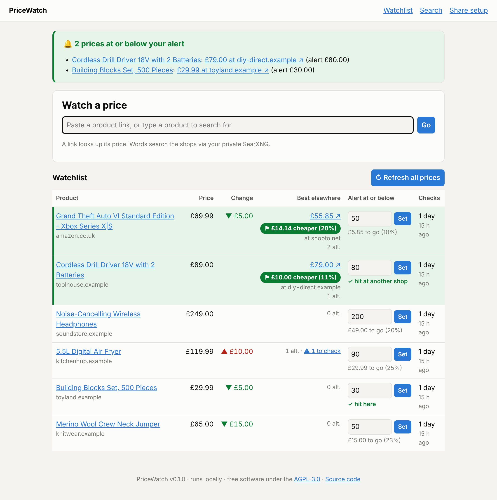
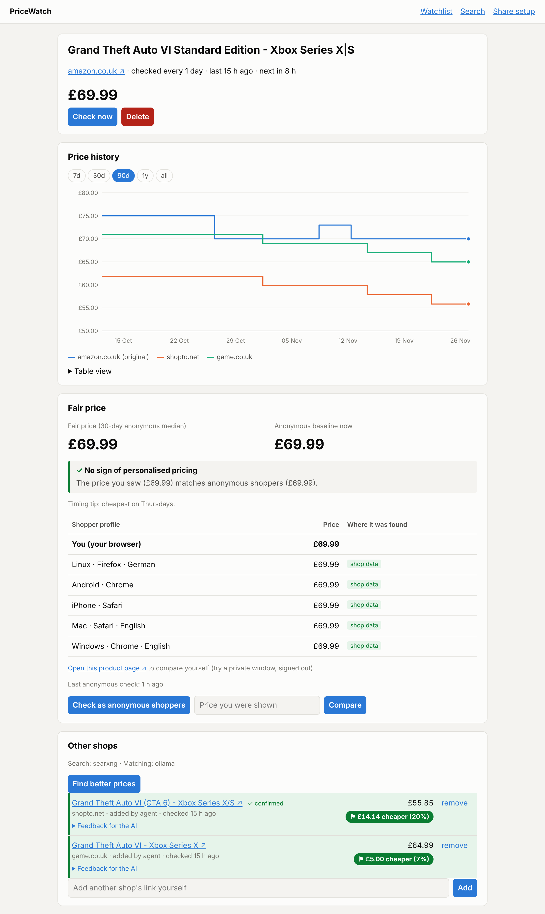

# PriceWatch

A **self-hosted, local-first price monitor and comparison tool**. Share a product link,
choose how often to check (every few minutes up to once a year), and PriceWatch tracks
the price. It can look for the same product cheaper elsewhere, graph price history, and
warn you about **personalised, surveillance and surge pricing**.

- Runs entirely on your machine, with **no runtime dependencies** (Python standard library only)
- No accounts, no cloud, no telemetry. Your shopping history stays in a local SQLite file
- AI features work with a **local** model (Ollama) and **self-hosted** search (SearXNG)
- Built so that **no secret is ever in the repo or visible to AI agents** (see [SECURITY.md](SECURITY.md))

| Version | Feature | Status |
|---|---|---|
| **v1** | Share or paste a link → price extracted → monitored at your chosen frequency | ✅ |
| **v2** | AI agent searches other shops, verifies prices, and adds matches to monitoring | ✅ |
| **v3** | Price-history graph: original vs alternatives, with hover, time ranges and a table view | ✅ |
| **v4** | **Fair Price:** anonymous multi-profile checks, your-price vs public-price, surge detection | ✅ |

<picture>
  <source media="(prefers-color-scheme: dark)" srcset="docs/screenshots/watchlist-dark.png">
  
</picture>

<details>
<summary><b>Product page:</b> price history, Fair Price and other shops</summary>

<picture>
  <source media="(prefers-color-scheme: dark)" srcset="docs/screenshots/product-dark.png">
  
</picture>
</details>

<sub>Screenshots use demo data (apart from GTA VI, the shops ending in `.example` are made up).
Regenerate them with `python3 docs/screenshots/make_screenshots.py`.</sub>

## Quick start

```bash
git clone https://github.com/Stevieag/pricewatch.git && cd pricewatch

# config lives OUTSIDE the repo
mkdir -p ~/.config/pricewatch
cp .env.example ~/.config/pricewatch/pricewatch.env
chmod 600 ~/.config/pricewatch/pricewatch.env

python3 -m pricewatch start        # starts SearXNG + Ollama (if used) + PriceWatch, opens the browser
```

| Command | What it does |
|---|---|
| `python3 -m pricewatch start` | Starts everything in the background: Docker Desktop and SearXNG if search is on, Ollama if AI matching is on, then PriceWatch. Waits until each one answers, then opens http://127.0.0.1:8765 |
| `python3 -m pricewatch status` | Shows what's running, plus whether start-at-login is on |
| `python3 -m pricewatch stop` | Stops PriceWatch and the SearXNG container (no other containers are touched) |
| `python3 -m pricewatch stop --all` | Also quits Ollama and Docker Desktop |
| `python3 -m pricewatch autostart on` | macOS: start everything when you log in, so the bookmarklet always works (`off` to undo) |
| `python3 -m pricewatch serve` | Runs PriceWatch in the current window instead (Ctrl+C to stop) |

The background server logs to `~/.local/share/pricewatch/pricewatch.log`.

Requires Python 3.9+ (the one built into macOS works). Nothing to `pip install`.

Try the extractor on its own: `python3 -m pricewatch check https://shop.example/product`
Re-check everything in your database right now: `python3 -m pricewatch check-all` (add `--no-fair` to skip Fair Price)

### With Docker (includes the local AI stack)

```bash
docker compose up -d                       # PriceWatch only
docker compose --profile ai up -d          # + SearXNG + Ollama
docker compose exec ollama ollama pull gemma4:e2b
```

> The Docker image has no browser, so shops that block plain requests (e.g. Argos) can't be
> read from inside it. For those, run PriceWatch directly with `python3 -m pricewatch start`.
> SearXNG and Ollama can still run in Docker alongside it.

For the AI profile, set these in your env file:
`PW_SEARCH_PROVIDER=searxng`, `PW_LLM_PROVIDER=ollama`, and
`SEARXNG_SECRET=$(openssl rand -hex 32)`.

## v1 — Watch a price

There are four ways to add a product:

1. **Paste** a link into the box on the home page. Pasting the whole shared text also
   works ("Look at this! https://…").
2. **Bookmarklet** (desktop): see the *Share setup* page and drag **+ PriceWatch** to
   your bookmarks bar.
3. **Share sheet** (Android / desktop Chrome): install PriceWatch as an app from the
   browser menu, and it appears as a share target.
4. **iPhone Shortcut**: see [docs/ios-shortcut.md](docs/ios-shortcut.md).

> The bookmarklet, share sheet and Shortcut all send the link to PriceWatch on your computer,
> so **PriceWatch must be running**. If it isn't, the browser shows "can't connect" and nothing
> is added. Run `python3 -m pricewatch autostart on` once (macOS) so it starts whenever you log in.

**Using it from your phone or another computer?** PriceWatch is local-only by default, which
is safest. If you want remote access, see [docs/remote-access.md](docs/remote-access.md) for
the safe way (a private Tailscale network) and what not to do.

PriceWatch fetches the page and finds the price. It tries, in order: schema.org
JSON-LD, microdata, Open Graph product tags, then a text heuristic. You'll see the
price, then choose a frequency (*every N minutes / hours / days / weeks / months /
years*, from `PW_MIN_INTERVAL_MINUTES` up to 1 year) and an optional target price.

**Search from inside PriceWatch.** Type a product name instead of a link (or use **Search** in the
menu). PriceWatch searches through your private SearXNG and hides results that aren't shop product
pages, such as social, news, reviews, price-comparison, search and category pages. It shows at most two per
shop. **Watch this** reads that page's price and asks how often to check it.

On the watchlist you can:
- **Refresh all prices**: re-checks every product and alternative now. The page updates itself
  until the checks finish. At most two invisible browsers run at once for shops that need one.
- **Set an alert price** on each row (blank removes it). Each row shows *✓ hit*, or how far the
  best price is from your alert. A banner lists every product at or below its alert, including
  when another shop is the one that dropped.

> **Be a polite bot.** Hourly or daily is plenty for most products.
> Some large retailers block automated requests or build prices with JavaScript. Those
> pages show "No price found" (see Roadmap).

## v2 — AI agent finds better prices

Press **Find better prices** on any item, or set `PW_AGENT_INTERVAL_HOURS` to run it on
a schedule.

1. The LLM writes a search query from the product title.
2. SearXNG (self-hosted) returns candidate shops.
3. **PriceWatch fetches each page itself** and extracts the real price. The AI never
   makes up prices.
4. The LLM answers one question per candidate: *same product?* This excludes
   accessories, other sizes and refurbished units. With no LLM configured, a strict
   heuristic does the matching (model numbers must match).
5. Matches in the same currency are added as monitored alternatives. You can remove any of them.

**Setting it up on a Mac:** install Docker Desktop and Ollama, then run
`ollama pull gemma4:e2b` and `docker compose --profile search up -d searxng`. Set
`PW_SEARCH_PROVIDER=searxng` and `PW_LLM_PROVIDER=ollama` in your env file. Then:

```bash
python3 -m pricewatch doctor          # checks config, Ollama, the model, SearXNG and the browser
python3 -m pricewatch find-better     # search for every product now (or: find-better 3)
```

**Teaching the agent (feedback for the AI).** Prices far below the rest (under 60%), or that
the AI thinks aren't the full price, are added but marked **⚠ check this price**. They don't
count as cheaper, or trigger alerts, until you confirm them. Under each shop on the product page:
- **✓ Correct**: the price counts.
- **£ Wrong price**: paste the right link, e.g. O2's `?paymentTab=pay-in-full` page. If the new
  link is the same page with extra options, PriceWatch adds them to that shop's links in future.
- **✕ Not the same product**: removed, and the agent never re-adds that link.
- **A note** ("£20 is monthly…") is passed to the AI as advice whenever it judges that shop again.

The agent only adds a shop automatically when:
- it's a shop, not a social, video, news, review or price-comparison site;
- it's one product's page, not a search or category list;
- the price comes from the shop's own product data, not the page text.

Monthly, instalment and deposit offers are ignored when a page also lists the pay-in-full
price. A shared manufacturer model number (e.g. BEMWH551) counts as the same product even if
the AI says otherwise. Every scheduled re-check of another shop re-judges its price, so a
listing that starts reporting a monthly or page-text price gets flagged again.

Shops the agent checked but didn't add are listed with their price and the reason, with
**Add anyway** for when you know better. Product titles are cleaned before searching
(repeated brand names, prices and shop names removed), and two searches are run and combined.

You can also add another shop's link by hand. `PW_LLM_PROVIDER` can be `ollama`
(recommended, fully local), `openai_compatible` (LM Studio, llama.cpp, vLLM…) or
`anthropic`.

## v3 — Price history graph

Each item page has a step-line chart covering the original shop and up to five
alternatives. It has:
- a 7d / 30d / 90d / 1y / all range selector
- a hover crosshair showing every shop's price at that moment
- a legend, and a **table view** for accessibility
- light and dark mode

The chart is rendered server-side as SVG, so no chart library or CDN is needed.

## v4 — Fair Price (personalised, surveillance and surge pricing)

Shops increasingly charge different people different prices, based on device, location,
browsing history, loyalty-account data, or demand. Fair Price checks for this in three ways:

| Signal | How it works | What you see |
|---|---|---|
| **Personalised / surveillance pricing** | The bookmarklet reads the price *you* are shown in your own signed-in browser. PriceWatch fetches the same page as anonymous shoppers (no cookies, no login, no history). | "You were shown £59.99 but anonymous shoppers got £47.50 (+26%)" |
| **Profile pricing** | Five anonymous profiles: Windows/Chrome, Mac/Safari, iPhone, Android, Linux/Firefox in German. Add `PW_FAIR_PROXIES` to also test from other network exits or regions (e.g. VPN endpoints). | "Cheapest as Windows · Chrome, dearest as iPhone · Safari" |
| **Surge pricing** | Compares the current price with the 30-day median of every check, and learns which weekday and time of day is cheapest. | "Surge: +22% above usual. Consider waiting" · "Timing tip: cheapest on Tuesdays" |

On shops with strong bot protection (e.g. Argos), devices can't be imitated: the protection
spots a browser claiming to be something it isn't. PriceWatch then uses honest anonymous visits
in your installed browser's real identity (fresh profile, English and German), spaced out. That
still answers the key question, *is the price I see higher than an anonymous visitor's?*, and
the profile rows show "skipped" with the reason.

Every profile row shows **where its price was found**: *shop data* (the shop's own structured
product data, reliable) or *page text*, with the words around it. "Price changes by device"
is only reported when both prices come from shop data. A difference read from page text is shown
as **"Possible lower price, unconfirmed"**, because on pages like Amazon's it is often a used
copy, another seller or another edition. Used, other-seller, refurbished and renewed prices are
skipped when reading pages. To see what one device gets, and why, run
`python3 -m pricewatch check "<link>" --as android` (or `iphone`, `windows`, `mac`, `linux`).

The **Fair price** figure is the 30-day median of anonymous prices. Persona checks run
when you add an item, every `PW_FAIR_INTERVAL_HOURS`, and on demand.

Privacy note: the bookmarklet sends only the link and the visible price to your own
PriceWatch. No cookies or account data leave the shop page.

## Configuration

Every variable is documented in [.env.example](.env.example). Run
`python3 -m pricewatch config` to see the effective config. Secrets appear only as
`set: true/false`.

## Development

```bash
python3 -m unittest discover -s tests -v       # 36 tests (browser tests skip if no Chrome/Firefox)
python3 scripts/check_secrets.py               # must pass before every commit
python3 scripts/live_test.py "<product link>"  # full live run against a real shop (temp data)
ln -s ../../scripts/pre-commit-hook.sh .git/hooks/pre-commit   # or: pre-commit install
```

Using an AI coding agent on this repo? It will pick up [AGENTS.md](AGENTS.md) /
[CLAUDE.md](CLAUDE.md) and the deny rules in `.claude/settings.json`.

```
pricewatch/
  config.py    settings + Secret wrapper (env file outside repo)
  util.py      URL cleaning, frequency + price parsing
  fetcher.py   SSRF-guarded HTTP client + headless Chrome/Firefox fallback for blocked shops
  extract.py   price/title extraction (JSON-LD, microdata, meta, heuristic)
  db.py        SQLite schema + queries
  monitor.py   price checks + background scheduler
  agent.py     v2 AI search agent
  chart.py     v3 SVG chart
  fair.py      v4 Fair Price
  web.py       web UI + JSON API (CSRF, CSP, Host allowlist, auth)
  static/      CSS, chart hover JS, icon
scripts/
  check_secrets.py   secret scanner (pre-commit + CI)
  live_test.py       full live test against a real shop
  pre-commit-hook.sh plain git hook
tests/               unit, end-to-end (fake shop) and browser-fallback tests
docs/                iPhone Shortcut guide
```

## Troubleshooting a shop

Run `python3 -m pricewatch check "<product link>"`. It prints the title, price and
`method`, which shows where the price was found:

| method | meaning |
|---|---|
| `jsonld` / `microdata` / `meta` | structured data, the most reliable |
| `price-element` | visible text inside an element labelled "price" (e.g. Argos) |
| `heading` / `heuristic` | first sensible £/$/€ amount; double-check it |
| `none` | no price found, even after the browser retry |

**Blocked shops (HTTP 403).** Some shops, such as Argos, refuse plain automated requests.
If Google Chrome, Edge, Brave, Chromium or **Firefox** is installed, PriceWatch automatically
retries with the browser running invisibly, using a **fresh throw-away profile**. Your cookies,
logins and history are never used. You'll see `+browser` in `method`. Settings:
`PW_BROWSER_FETCH=auto|always|never`, plus `PW_BROWSER_PATH` if the browser is somewhere unusual.
Chromium-family browsers are tried first: Firefox reports when it is being automated,
and some bot protection picks up on that. If even that is blocked, check less often: bot protection reacts to frequent visits.

## Roadmap

- Alerts when a target is hit, or on surge or personalised-price warnings (email via SMTP, ntfy, Apprise)
- Currency conversion so alternatives in other currencies can be compared
- Per-site extraction rules contributed by the community
- CSV export / import

See [CHANGELOG.md](CHANGELOG.md) for what changed in each version, and
[CONTRIBUTING.md](CONTRIBUTING.md) to get involved.

## Licence

Copyright (C) 2026 Stevieag and PriceWatch contributors.

PriceWatch is free software under the **GNU Affero General Public License v3.0 or later**
(AGPL-3.0-or-later); see [LICENSE](LICENSE). You can use, study, change and share it. If you
distribute a modified version, or **run a modified version as a service that other people
use over a network**, you must offer those users its complete source code under the same
licence (AGPL section 13). PriceWatch's footer has a *Source code* link for this. If you run
a modified copy for others, set `PW_SOURCE_URL` to where your version's code is published.

The licence covers the software only. Respect each site's terms of service and robots rules.
